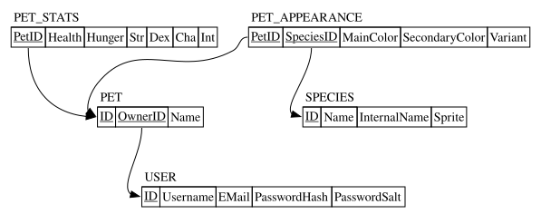

# Database Reltationships

All of this is a WIP and is subject to change

## Entities

### User: 3NF
- ID: Identifier of Self
- email: String
- username: String
- password: Compound:
	- hash: String
	- salt: String

### Pet: 3NF
- ID: Identifier of Self
- owner: Identifier of User
- name: String

### PetAppearance: 3NF
Something like this could probably more easily implemented through just storing a few attributes and identifiers and having the frontend handle the rest. But we'll implement it this way for now
- PetID: Identifier of Pet
- SpeciesID: Identifier of Species
- mainColor: Color
- secondaryColor: Color
- variant: int

### Species: 3NF
- ID: Identifier of Self
- name: String
- internalName: String
- basesprite: Unstructured Image (likely stored as a link)

### PetStats: 3NF
- PetID: Identifier of Pet
- health: int
- hunger: int
- strength: int
- dexterity: int
- charisma: int
- intelligence: int

## "Business" rules

**User**s can *Adopt* multiple **Pet**s, but **Pet**s can be *Adopted* by at most one **User**

**Pet**s' apperances are *Determined by* a single **PetAppearance**, and **PetAppearance**s can only *Apply to* a single **Pet**

**PetAppearance**s *Refer To* a single **Species**, but a **Species** can be *Referenced by* many **PetAppearance**s

**Pet**s *have* a single **PetStats**, and **PetStats** *describe* a single **Pet**

## Diagrams

### ERD
TODO

### Relations Diagram
This shows the relationships between different items, and how they are referenced in relation to each other.

