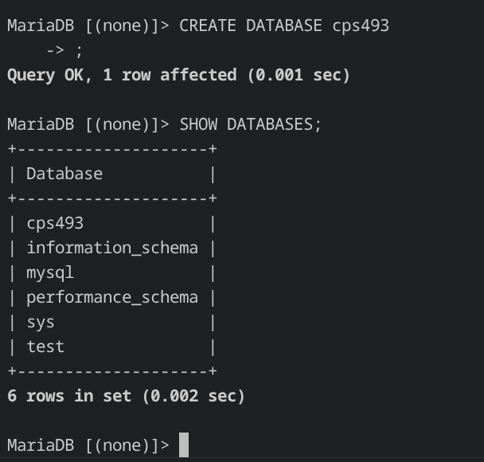
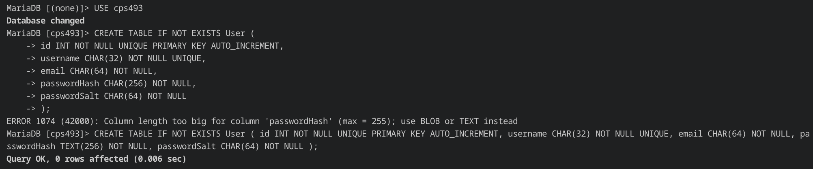
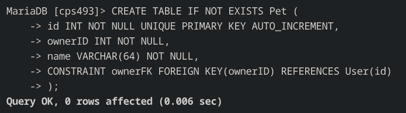
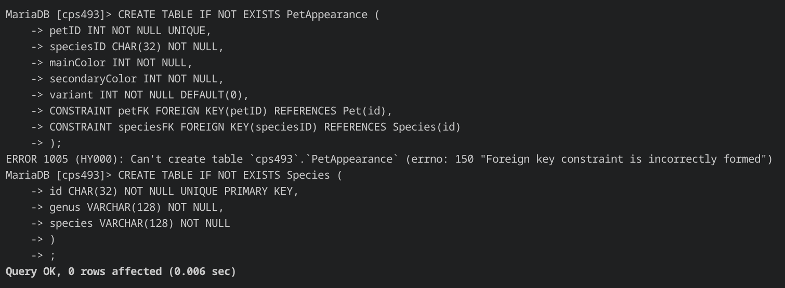
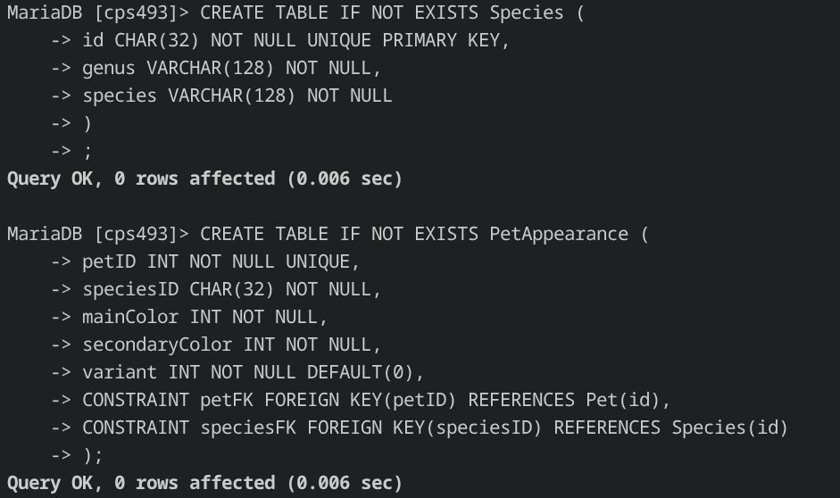
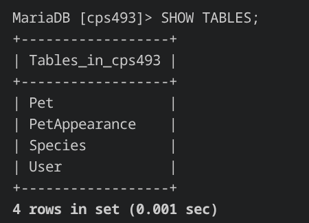
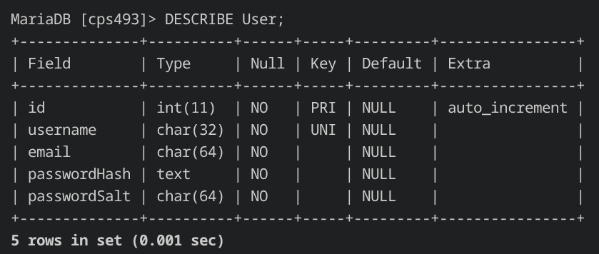

## What is this?
The goal of this site is to be a 2000s style virtual pet website in the style/spirit of something like neopets. Users will be able to register and login, create new pets, view and share their pets, and later down the line they may even be able to play games with them. In typical fashion with me and my autism, the pets will be dinosaurs, and the whole website will take on a fossil motif.
This is not meant to be a serious project, the goal is to create an early web 2.0 style site with basic dynamic content and ultimately fulfil the needs of the assignment.

## Database Implementation
This project uses MariaDB, a fork of MySQL

The tabled that have been implemented are: `User`, `Pet`, `PetAppearance`, and `Species`

`User` contains users, `Pet` contains pets which are owned by users, `PetAppearance` contains the appearances of each pet, and `Species` contains all possible species that a pet can be.

Creation of the database:

Creation of the `User` table

Creation of the `Pet` table

Failure to create the `PetAppearance` table, because it is dependent on the `Species` table. The `Species` table is then created first

Creation of `PetAppearance` after successfully creating `Species`

All created tables listed

Description of table `User`
